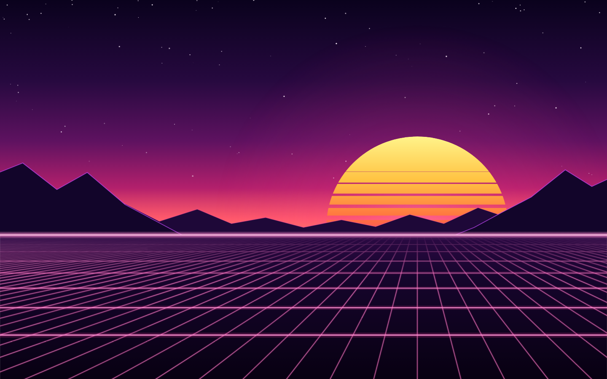

# Synthwave Sunset

A Claude Code theme (a mod) for the desktop and mobile apps: a neon synthwave sunset.



- **Backdrop:** an animated scene. A striped sun sets behind violet mountains, a glowing pink grid rolls toward you, stars twinkle, and a shooting star crosses now and then. On wide screens the sun sits in the right third, away from the text. On phones it sits in the centre and is drawn smaller. If your system asks for reduced motion, the scene holds still.
- **Colors:** dark mode only. Deep violet surfaces, hot-pink accent, sunset-amber warnings, teal-green success and violet for literals. Code highlighting uses the same colors.

The terminal and editor extensions don't draw themes, so this theme only shows in the desktop and mobile apps.

## Use it

Load the folder as a plugin directory:

```sh
claude --plugin-dir ./claude-themes/synthwave-sunset
```

The theme is set when the session starts. Files:

- `hooks/register.tsx` sets the colors and draws the backdrop.
- `hooks/scene.ts` builds the animated SVG scene.
- `hooks/make-colors.js` is the design system's color helper. Don't edit it.

Run the tests with `claude plugin test claude-themes/synthwave-sunset`.
